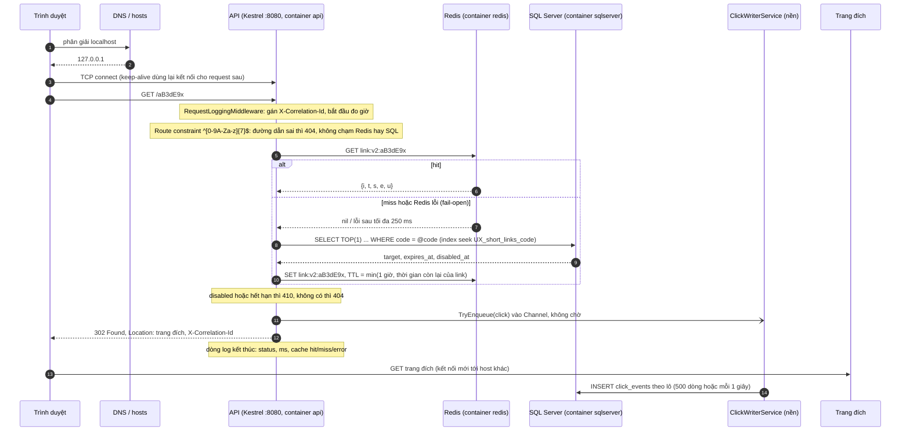
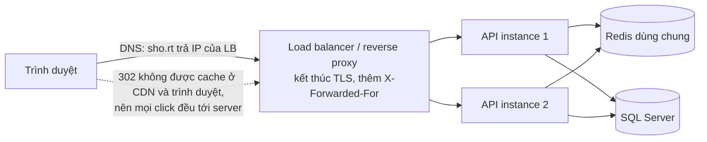

# URL Shortener

URL shortener viết bằng ASP.NET Core 9 (Minimal API), EF Core 9, SQL Server 2022 và Redis 7.4 (cache-aside).

Giá trị của project không nằm ở tính năng rút gọn link mà ở quá trình đo có kiểm soát: dựng bản chỉ dùng SQL, đo baseline, thêm Redis cache-aside, xử lý khi Redis lỗi, rồi đo lại trong cùng điều kiện. Mọi con số hiệu năng trong repo phải có file kết quả gốc và commit đi kèm.

Trạng thái hiện tại (Ngày 24, ứng viên v1.0):
- Tạo link, redirect 302/404/410, quản lý link bằng API key.
- Redis cache-aside cho redirect, xoá key sau khi commit, Redis lỗi thì đọc thẳng SQL.
- Click analytics: mặc định bất đồng bộ (Channel cùng worker ghi theo lô), có endpoint thống kê theo ngày UTC.
- Log JSON có CorrelationId và CacheResult.
- Baseline và các chế độ A/B/D/E đã đo thật (benchmarks/REPORT.md). Chế độ F (analytics bất đồng bộ) đã có trong bộ đo nhưng chưa đo.

## Cache

- Redirect đi qua IRedirectReader. Khi bật cache, SqlRedirectReader được bọc bởi CachedRedirectReader (Decorator): đọc Redis trước, miss thì đọc SQL rồi ghi Redis với TTL = min(Cache:LinkTtl, thời gian còn lại của link). Code không tồn tại không bị cache.
- Key link:v2:{code}, value JSON gọn {i, t, s, e, u}. Key chuyển từ v1 sang v2 khi value thêm link id ở Ngày 22.
- Cache:Provider chọn Redis, Memory (LRU trong process, Singleton) hoặc None. Bỏ trống thì có ConnectionStrings:Redis là Redis, không có là None.
- Sửa hoặc disable link: commit SQL trước, rồi xoá key. Xoá lỗi chỉ log Warning; TTL là giới hạn trên cho dữ liệu cũ.
- Redis chết: lệnh Redis fail ngay (BacklogPolicy.FailFast, timeout 250 ms), redirect đọc SQL, log Warning tối đa 10 giây một lần, /health/ready báo Degraded nhưng vẫn 200. Redis lên lại thì tự dùng cache, không cần restart API.
- Giới hạn đã biết: chưa có negative caching (US-06) và chống stampede (US-09), cả hai để giai đoạn 2. Cache Memory là riêng từng instance, nên xoá cache ở instance này không tới instance khác.

## Problem

- Redirect là thao tác đọc chiếm phần lớn traffic; mỗi request đọc DB thì DB thành điểm nghẽn.
- Thêm cache sinh vấn đề mới: dữ liệu cũ sau khi sửa link, Redis chết làm hỏng redirect.
- Ghi thống kê ngay trong request redirect làm chậm chính thao tác quan trọng nhất.
- Không đo thì câu "Redis giúp nhanh hơn" chỉ là giả định.

## Scope

In scope: tạo link, redirect, quản lý link bằng API key; baseline SQL; Redis cache-aside (TTL, xoá cache khi sửa link, fail-open khi Redis lỗi); benchmark k6; click analytics theo ngày; Docker Compose, CI, structured logging.

Out of scope: giao diện web, đăng ký tài khoản, JWT/role, multi-region, CDN thật, Redis Cluster/Sentinel, Redis nâng cao (negative caching, stampede, distributed lock) để giai đoạn 2.

## Các mốc (git tag)

- v0.1-sql-baseline: tạo link, redirect, quản lý link, chưa có Redis; kết quả benchmark baseline gắn commit này.
- v0.2-redis-cache-aside: cache-aside, TTL, xoá cache khi sửa link.
- v0.3-resilience: Redis lỗi thì đọc thẳng SQL.
- v0.4-benchmark-compare: đo lại không cache, Redis warm, Redis down.
- v1.0: analytics, Docker, CI, tài liệu hoàn chỉnh.

## Cấu trúc

- src/UrlShortener.Api: Minimal API, endpoint, health check.
- src/UrlShortener.Infrastructure: truy cập SQL Server (EF Core), sau này là Redis.
- tests/UrlShortener.UnitTests và tests/UrlShortener.IntegrationTests.
- docs/: project definition, database design, API contract, ADR.

Vì sao chỉ 2 project mà không dùng Clean Architecture như OrderFlow: xem docs/adr/ADR-007-architecture-minimal-api.md.

## Chạy local

Cách 1, dùng LocalDB (Windows). Chưa có endpoint tạo API client, nên ở môi trường Development app đọc Seed:DevApiKey từ user-secrets, tự chạy migration và tạo client "dev" với key đó:

```powershell
dotnet user-secrets set "Seed:DevApiKey" "dev-local-key-change-me" --project src/UrlShortener.Api
dotnet run --project src/UrlShortener.Api
```

Rồi thử:

```powershell
curl.exe -s -H "X-Api-Key: dev-local-key-change-me" -H "Content-Type: application/json" -d '{\"url\":\"https://example.com\"}' http://localhost:5100/api/links
curl.exe -s -i http://localhost:5100/<code>
```

Health: http://localhost:5100/health/live và http://localhost:5100/health/ready.

Tạo migration mới (tool dotnet-ef đã khai báo trong .config/dotnet-tools.json):

```powershell
dotnet tool restore
dotnet ef migrations add <Ten> --project src/UrlShortener.Infrastructure --startup-project src/UrlShortener.Api --output-dir Data/Migrations
```

Cách 2, dùng Docker Compose. Máy sạch chỉ cần Docker. API tự chạy migration khi khởi động (Database:MigrateOnStartup), và tạo một API client từ BOOTSTRAP_API_KEY trong .env:

```powershell
Copy-Item .env.example .env
docker compose up --build --wait
```

Rồi thử, đổi key theo giá trị trong .env. Nếu cổng 8080 trên máy đã bị chiếm, đặt API_PORT trong .env:

```powershell
curl.exe -s -H "X-Api-Key: change-me-local-bootstrap-key" -H "Content-Type: application/json" -d '{\"url\":\"https://example.com\"}' http://localhost:8080/api/links
```

## Logging

- Ngoài Development, log ghi ra console dạng JSON, có scope.
- Mỗi request có CorrelationId. App lấy từ header X-Correlation-Id nếu giá trị an toàn, không thì tự tạo mới, rồi trả lại trong response. ProblemDetails.traceId cũng là giá trị này.
- Mỗi request có một dòng log khi kết thúc, gồm method, route template, status, thời gian (ms) và CacheResult (hit, miss, error, none). Health check chỉ log ở mức Debug.
- Lỗi không lường trước (GlobalExceptionHandler): log Error kèm exception, client chỉ nhận 500 ProblemDetails với traceId, không có chi tiết exception. Client tự ngắt kết nối thì chỉ log Information.

## Chạy test

Integration test dùng Testcontainers dựng SQL Server 2022 và Redis 7.4 thật, nên cần Docker Desktop đang chạy:

```powershell
dotnet test UrlShortener.sln
```

## Luồng request

### Hiện tại (docker compose trên một máy)

Đây là đường đi thật của GET /{code} trong code hiện tại. Không có load balancer, CDN hay TLS: compose chỉ mở HTTP ở cổng 8080 của máy.



### Khi chạy production (chưa làm, chỉ là hướng thiết kế)



Những điểm thay đổi so với hiện tại, chưa làm:
- TLS kết thúc ở load balancer; API sau LB đọc X-Forwarded-For và X-Forwarded-Proto (ForwardedHeaders) để biết IP thật của client và scheme thật.
- Correlation id nên được tạo ngay ở LB, để log của LB và log của API nối với nhau. API đã nhận sẵn header X-Correlation-Id nếu có.
- Nhiều instance thì cache Memory không dùng được (mỗi instance một bản riêng), nên phải dùng Redis. Mỗi instance có hàng đợi click riêng trong bộ nhớ, nên khi một instance crash chỉ mất click của instance đó.
- Migration phải chạy thành một bước riêng trước khi deploy, không chạy lúc khởi động (nhiều instance cùng migrate sẽ tranh nhau).
- CDN không giúp được redirect 302 (ADR-002 chọn 302 để mọi click tới server). Nếu muốn CDN cache thì phải dùng 301 hoặc Cache-Control, và đổi lại là mất khả năng đếm click và sửa link.

## Tài liệu

- docs/01-project-definition.md
- docs/02-database-design.md
- docs/03-api-contract.md
- docs/adr/ADR-001-short-code-strategy.md
- docs/adr/ADR-002-redirect-status-code.md
- docs/adr/ADR-003-caching-pattern.md
- docs/adr/ADR-004-cache-invalidation.md
- docs/adr/ADR-005-redis-failure.md
- docs/adr/ADR-006-analytics.md
- docs/adr/ADR-007-architecture-minimal-api.md
- docs/design-patterns.md
- docs/bugs.md
- benchmarks/REPORT.md

## Đo hiệu năng

Cần Docker Desktop và không có container nào khác đang chạy (chúng chia CPU và làm sai số đo; script sẽ từ chối chạy, trừ khi truyền -AllowOtherContainers và việc đó sẽ được ghi vào kết quả):

Chạy toàn bộ phép đo cho báo cáo, mất khoảng 25–30 phút:

```powershell
./benchmarks/run-all.ps1 -Commit HEAD
```

Hoặc chạy từng chế độ:

```powershell
./benchmarks/run-baseline.ps1 -Commit <commit> -Mode B -Name bench
```

Các chế độ:
- A: không cache.
- B: Redis đã warm.
- D: Redis bị tắt từ trước khi warm-up, nên mọi request đều đi SQL.
- E: Redis warm và bật analytics đồng bộ.
- F: Redis warm và bật analytics bất đồng bộ (chưa đo).

Script build API từ git archive của commit cần đo, nạp 100k link cố định, chạy k6 3 lần cho mỗi chế độ rồi ghi benchmarks/results/<name>-<mode>-<commit>.json. Báo cáo nằm ở benchmarks/REPORT.md.

Chế độ F (Redis đã warm, analytics bất đồng bộ) chạy bằng ./benchmarks/run-baseline.ps1 -Commit <commit> -Mode F -Name bench, nhưng chưa có số đo.
