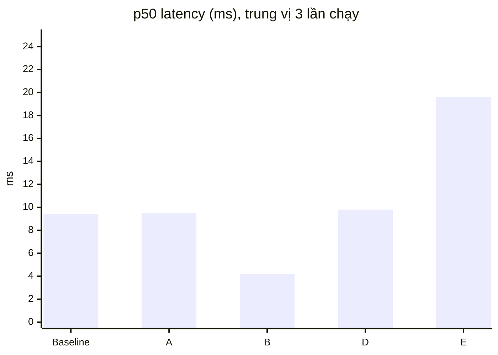
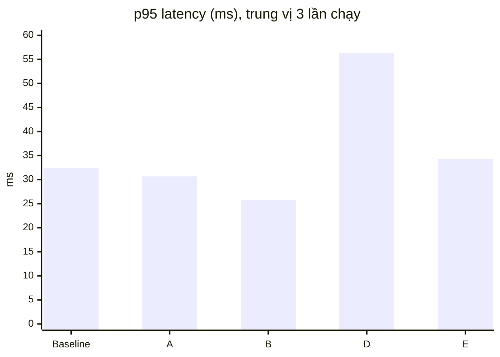
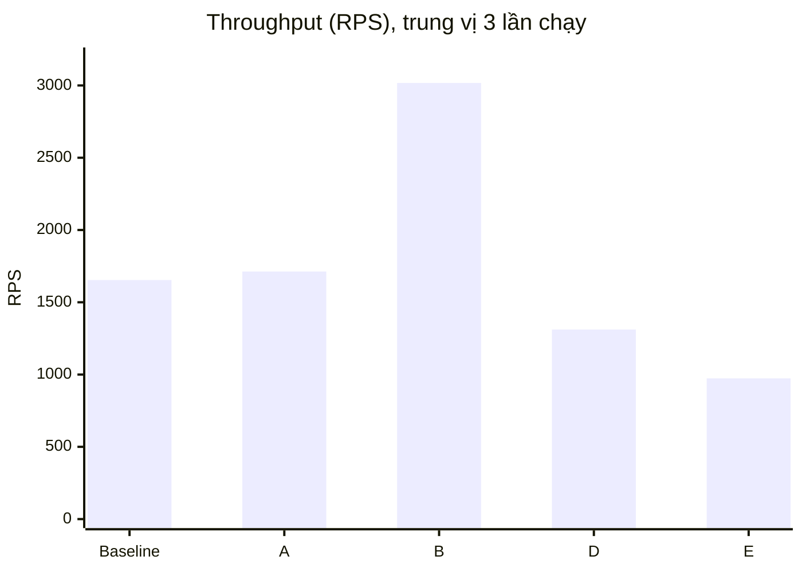

# Báo cáo hiệu năng redirect (US-10)

Mọi con số dưới đây lấy từ năm file trong benchmarks/results/. Đó là trung vị của 3 lần chạy, chưa làm tròn lại. Không có số nào ước lượng hay lấy từ lần chạy thử.

- baseline-A-15683bb.json: baseline SQL, code chưa có cache, đo lúc 2026-11-24 04:09 UTC.
- bench-A-ee9fd90.json, bench-B-ee9fd90.json, bench-D-ee9fd90.json, bench-E-ee9fd90.json: code có cache và analytics, đo từ 04:14 đến 04:28 UTC.

## Cách đo

- Máy: AMD Ryzen 5 5600H (6 nhân, 12 luồng), RAM 13,9 GB, Windows 11 Pro 10.0.26200. Docker 29.9.3, VM 12 CPU / 6,7 GB.
- Giới hạn container: API 2 CPU / 1 GB, SQL Server 2 CPU / 2 GB. SQL Server 16.0.4325.4 Developer Edition, Redis 7.4.12, k6 0.54.0.
- Không có container nào khác chạy trong lúc đo. Stack vanhng đã được dừng, và trường otherContainers trong cả năm file đều rỗng.
- Dataset: 100.000 link sinh tất định bằng benchmarks/sql/seed.sql. Index UX_short_links_code (unique, BIN2).
- Tải: k6 với 20 VU cố định. Mỗi lần chạy có 20 giây warm-up, sau đó đo 60 giây. Phần warm-up không tính vào số liệu và không tính vào số DB query.
- Phân bố request: 80% vào link nóng (20% số link), 15% vào link nguội, 5% vào code không tồn tại (trả 404).
- k6 chạy cùng máy và cùng Docker network với API, nên tranh CPU với API. Đây là giới hạn của phép đo: số tuyệt đối chỉ đúng cho máy này, chỉ so sánh tương đối giữa các chế độ mới có nghĩa.
- Toàn bộ chạy lại được bằng một lệnh: ./benchmarks/run-all.ps1 -Commit ee9fd90.
- B, D và E được đo với một thay đổi chưa commit trong runner: tên container dùng để đọc phiên bản k6. Thay đổi này được ghi trong harnessChanges. Nó không đụng tới API, vì image API luôn build từ git archive của commit.

## Kết quả (trung vị của 3 lần chạy)

Baseline, commit 15683bb, chỉ có SQL:
- p50 9,42 ms, p95 32,45 ms, p99 48,65 ms.
- 1653,7 RPS.
- 1 DB query mỗi request, lỗi 0%.
- Độ lệch giữa max và min so với trung vị: RPS 11,4%, p95 87,3%. Lần chạy 3 có p95 58,12 ms, trong khi hai lần đầu là 29,78 và 32,45 ms.

A, không cache, tắt analytics:
- p50 9,48 ms, p95 30,67 ms, p99 44,58 ms.
- 1712,9 RPS.
- 1 DB query mỗi request, lỗi 0%.
- Độ lệch: RPS 2,0%, p95 9,1%.

B, Redis warm, tắt analytics:
- p50 4,19 ms, p95 25,72 ms, p99 41,87 ms.
- 3017,2 RPS.
- 0,136 DB query mỗi request, hit ratio 0,8642, lỗi 0%.
- Độ lệch: RPS 33,3%, p95 36,5%.
- Hit ratio tăng dần qua ba lần chạy: 0,7328, rồi 0,8642, rồi 0,8933.

D, Redis bị dừng, mọi request đi SQL:
- p50 9,80 ms, p95 56,27 ms, p99 66,41 ms.
- 1311,4 RPS.
- 1 DB query mỗi request, hit ratio 0, lỗi 0%.
- Độ lệch: RPS 3,4%, p95 10,6%.

E, Redis warm, bật analytics đồng bộ:
- p50 19,60 ms, p95 34,32 ms, p99 48,91 ms.
- 973,6 RPS.
- 1,13 DB query mỗi request, hit ratio 0,8192, lỗi 0%.
- Độ lệch: RPS 19,1%, p95 25,0%.

## So sánh

- B so với A: RPS tăng 76,1%, p50 giảm 55,8%, p95 giảm 16,1%, p99 giảm 6,1%. Số DB query mỗi request giảm từ 1 xuống 0,136, tức giảm 86,4%.
- D so với A: RPS giảm 23,4%, p50 tăng 3,4%, p95 tăng 83,5%, p99 tăng 49,0%.
- E so với B: RPS giảm 67,7%, p50 tăng 367,8% (gấp khoảng 4,7 lần), p95 tăng 33,4%. DB query mỗi request tăng từ 0,136 lên 1,13. Phần tăng thêm khoảng 1 query khớp với một INSERT cho mỗi request trả 302, mà 302 chiếm 95% request.
- E so với A: RPS giảm 43,2%, p50 tăng 106,8%, p95 tăng 11,9%. Bật analytics đồng bộ thì dù có cache, hệ thống vẫn chậm hơn cả lúc không cache.
- A so với baseline: RPS chênh 3,6%, p95 chênh 5,5%. Cả hai nằm trong độ lệch của baseline (RPS 11,4%), nên không thấy được chi phí của lớp trừu tượng IRedirectReader.

## Câu hỏi phân tích

Lợi ích chính của cache thể hiện ở latency hay ở số DB query? Ở số DB query và throughput. DB query giảm 86%, RPS tăng 76%, p50 giảm hơn một nửa. Nhưng p95 chỉ giảm 16% và p99 chỉ giảm 6%. Lý do là đuôi latency vẫn do các request miss quyết định, mà miss thì vẫn phải đi SQL: 5% code không tồn tại luôn miss, cộng với link nguội được đọc lần đầu. Thêm nữa, k6 chạy cùng máy nên tranh CPU khi RPS tăng gấp đôi. Đây là giả thuyết, phép đo này chưa tách được hai nguyên nhân.

Hit ratio bao nhiêu thì cache bắt đầu có lợi? Dữ liệu chỉ có vài điểm. Ở hit ratio 0,7328 (B, lần 1), RPS là 2193,6, cao hơn A 28%, nhưng p95 là 33,74 ms, tệ hơn A (30,67 ms). Ở 0,8642 và 0,8933, cả RPS lẫn p95 đều tốt hơn A. Vậy với workload này, throughput đã có lợi từ khoảng 0,73, còn p95 chỉ có lợi từ khoảng 0,86 trở lên. Lưu ý là lần 1 còn đang tốn nhiều lệnh SET để làm đầy cache, nên hai yếu tố này bị trộn vào nhau. Nếu traffic phân bố đều, không có key nóng, thì phần lớn request sẽ miss lần đầu và hit ratio sẽ thấp hơn nhiều. Phép đo này không có chế độ đó; đó là chế độ C, để giai đoạn 2.

Chế độ D chậm hơn A bao nhiêu? p50 gần như không đổi (+3,4%), nhưng p95 tăng 83,5% và RPS giảm 23,4%. Nghĩa là fail-open hoạt động đúng: lỗi 0% và không request nào bị treo. Nhưng nó không miễn phí. Nhờ BacklogPolicy.FailFast, mỗi lệnh GET và SET thất bại ngay chứ không chờ. Giả thuyết là chi phí nằm ở việc tạo và bắt exception hai lần mỗi request, cộng với vòng thử kết nối lại mỗi giây, trên một container chỉ có 2 CPU. Chưa đo để xác nhận. Hướng cải thiện có thể là một circuit breaker: sau N lần lỗi liên tiếp thì bỏ qua Redis hoàn toàn một thời gian. Chưa làm. Trước khi bật FailFast, thử tay trên compose thì mỗi redirect mất 1–4 giây khi Redis tắt. Đó là quan sát định tính lúc phát triển, không phải số benchmark.

Analytics đồng bộ tốn bao nhiêu? Đây là chi phí lớn nhất trong báo cáo. So với B, throughput giảm 67,7% và p50 tăng gấp khoảng 4,7 lần. Mỗi lần trả 302 phải chờ một INSERT có commit vào SQL Server, nên cache gần như mất tác dụng với latency. Số liệu này là lý do để làm US-13: đưa click vào Channel có giới hạn, rồi để worker ghi theo lô. Cái giá là có thể mất event khi app crash.

## Vì sao chọn cache-aside

Cache-aside là app tự đọc cache, miss thì đọc DB rồi ghi vào cache; khi ghi thì commit DB rồi xoá key. Có ba lý do:
- Redis chỉ là bản sao có thể mất. Khi Redis chết, app vẫn chạy bằng DB: chế độ D cho lỗi 0%, chậm hơn nhưng không sập.
- Chỉ link nào thật sự được đọc mới vào cache. Với phân bố 80/20, bộ nhớ chủ yếu dành cho link nóng.
- Logic nằm trong code của mình và test được. CachedRedirectReader là một Decorator bọc SqlRedirectReader.

Hai cách khác, ở mức khái niệm:
- Write-through: ghi DB và cache cùng lúc. Cache luôn mới, nhưng mỗi lần ghi chậm hơn và cache chứa cả link không ai đọc.
- Write-behind: ghi cache trước, ghi DB sau. Ghi nhanh, nhưng Redis chết là mất dữ liệu, không chấp nhận được khi SQL là nguồn sự thật.

## Khi nào cache không giúp (theo số đo ở trên)

- Khi Redis chết: cache không những không giúp mà còn làm hệ thống chậm hơn lúc không có cache. D có p95 56,27 ms, còn A là 30,67 ms. Có cache nghĩa là có thêm một chế độ lỗi phải trả giá.
- Khi request phải ghi DB đồng bộ: E có p50 19,60 ms, chậm hơn cả A (9,48 ms) dù hit ratio là 0,82. Cache chỉ bỏ được phần đọc, còn phần ghi vẫn nằm trên đường đi của request.
- Với đuôi latency: p99 chỉ giảm 6%, vì miss vẫn đi SQL. Ai quan tâm p99 thì cache không giải quyết được.
- Khi cache còn lạnh: hit ratio 0,73 ở lần chạy đầu cho p95 tệ hơn không cache.
- Code không tồn tại (5% traffic) luôn miss. Negative caching (US-06) để giai đoạn 2.
- Một nhận xét chung, chưa đo: index seek trên 100k dòng vốn đã nhanh (p50 khoảng 9,5 ms đã bao gồm cả HTTP và tranh CPU với k6). Khi DB còn nhẹ như vậy, lợi ích chính của cache là giảm tải DB, không phải giảm latency.

## Giới hạn của phép đo

- Warm-up 20 giây là chưa đủ cho B và E: hit ratio vẫn tăng giữa các lần chạy, nên độ lệch của B lên tới 33,3% RPS. Lần chạy 3 của B (hit ratio 0,8933, 3198,5 RPS, p95 24,34 ms) gần trạng thái ổn định hơn trung vị. Lần sau nên warm-up lâu hơn, hoặc warm-up bằng cách quét hết các link.
- Baseline có một lần chạy lệch hẳn (p95 58,12 ms so với khoảng 30 ms của hai lần còn lại). Trung vị không bị ảnh hưởng, nhưng nó cho thấy máy dev không ổn định bằng máy đo riêng.
- k6 và API cùng máy. Chế độ C (cache lạnh, TTL hết hạn) chưa đo.

## Checklist mục 13

- Commit hash, CPU, RAM, OS, giới hạn Docker, phiên bản SQL Server và Redis: có, nằm trong từng file JSON và ở phần Cách đo.
- Kích thước dataset, index, seed, tỉ lệ nóng/nguội/không tồn tại: có.
- Số VU, thời lượng, warm-up, TTL (1 giờ, link seed không hết hạn), analytics bật hay tắt, số lần chạy: có.
- k6 và API cùng máy: có, đã ghi là giới hạn.
