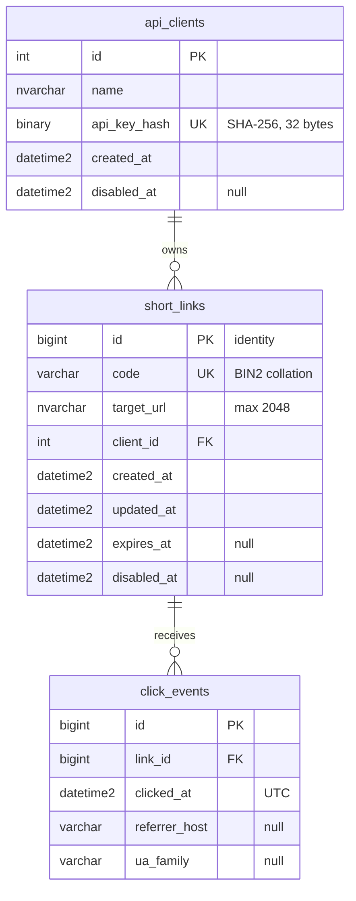

# 02. Database Design

SQL Server là nguồn sự thật. Redis (từ v0.2) chỉ là bản sao tạm thời có thể mất.

## ERD

## api_clients

- id int identity, PK.
- name nvarchar(100), not null.
- api_key_hash binary(32), not null, UNIQUE. Lưu SHA-256 của key, không bao giờ lưu key thô. Key sinh bằng CSPRNG, chỉ hiển thị một lần khi tạo.
- created_at datetime2, not null, UTC.
- disabled_at datetime2 null. Client bị vô hiệu hoá thì key trả 401.

Vì sao SHA-256 đủ cho API key mà password lại cần PBKDF2/bcrypt: key ngẫu nhiên 32 byte có entropy rất cao nên brute force không khả thi dù hash nhanh; password do người đặt có entropy thấp nên cần hash chậm có salt. Hash nhanh còn giúp tra cứu key mỗi request bằng index.

## short_links

- id bigint identity, PK.
- code varchar(16), not null, collation Latin1_General_100_BIN2, UNIQUE.
- target_url nvarchar(2048), not null.
- client_id int, not null, FK tới api_clients.
- created_at datetime2, not null, UTC.
- updated_at datetime2, not null, UTC. Đổi mỗi khi sửa target, expiry, disable; dùng làm version khi chống stale cache (US-07).
- expires_at datetime2 null. Quá hạn thì redirect trả 410.
- disabled_at datetime2 null. Đã disable thì redirect trả 410.

Index:

- UX_short_links_code trên code. Đây là index phục vụ redirect, truy vấn phải là index seek.
- IX_short_links_client_id_created_at trên (client_id, created_at) cho endpoint list có phân trang.

Bẫy collation: collation mặc định của SQL Server (SQL_Latin1_General_CP1_CI_AS) không phân biệt hoa thường, nên abc và ABC bị unique index coi là trùng, trong khi Base62 coi đó là hai code khác nhau. Hậu quả là vừa giảm không gian code, vừa có thể redirect nhầm nếu truy vấn dùng WHERE code = 'abc'. Vì vậy cột code dùng _BIN2 (so sánh theo byte, phân biệt hoa thường, nhanh nhất). Phải có integration test trên SQL Server thật chứng minh abc và ABC lưu được thành hai link.

Vì sao varchar mà không nvarchar cho code: code chỉ gồm ký tự Base62 ASCII, varchar tốn nửa dung lượng và index nhỏ hơn.

## click_events

- id bigint identity, PK.
- link_id bigint, not null, FK tới short_links.
- clicked_at datetime2, not null, UTC.
- referrer_host varchar(255) null. Chỉ giữ host, không giữ full URL.
- ua_family varchar(50) null. Chỉ giữ họ trình duyệt.

Index: IX_click_events_link_id_clicked_at trên (link_id, clicked_at) cho truy vấn thống kê theo khoảng ngày. Cột so sánh bằng (link_id) đứng trước, cột so sánh khoảng (clicked_at) đứng sau, nên WHERE link_id = @id AND clicked_at >= @from AND clicked_at < @to là một lần range seek. Nếu đảo thứ tự cột, SQL Server phải đọc mọi click của mọi link trong khoảng ngày đó rồi mới lọc theo link. Index này còn phủ được truy vấn GROUP BY CAST(clicked_at AS date), nên không cần key lookup. Có integration test đọc execution plan để kiểm tra đây là Index Seek trên đúng index này.

Khoảng ngày dùng nửa mở: clicked_at >= from 00:00 và < (to + 1 ngày) 00:00. Cách này lấy trọn ngày "to" mà không phải viết 23:59:59.999, và không bọc hàm quanh clicked_at trong WHERE, nên index vẫn dùng được (sargable).

Ghi click hiện chạy đồng bộ trong request redirect: mỗi lần trả 302 tốn thêm một INSERT. Chi phí này được đo ở chế độ E của benchmark. Bản bất đồng bộ (Channel + worker ghi theo lô, US-13) sẽ bỏ được chi phí đó khỏi redirect, đổi lại có thể mất event khi app crash.

Không lưu IP thô (SEC-04). Nếu cần đếm unique visitor thì hash IP có salt, để sau.

## daily_link_stats (P1, US-14)

- link_id bigint, day date, clicks int; PK (link_id, day). Worker cập nhật định kỳ.

## Thiết kế dữ liệu trong Redis (từ v0.2, ghi trước để thống nhất)

- link:v2:{code} chứa JSON gọn {i: linkId, t: target, s: status, e: expiresAt, u: updatedAt}. TTL tối đa 1 giờ và không vượt thời gian còn lại của link.
- Số version trong key để khi đổi định dạng value thì chỉ cần đổi version, key cũ tự hết hạn, không phải xoá hàng loạt. Việc này đã xảy ra thật ở Ngày 22: click analytics cần link id, nên value có thêm i, và key chuyển từ v1 sang v2.
- rl:create:{clientId}:{window} (P1) là bộ đếm rate limit.

## Câu hỏi tự kiểm tra

- Vì sao code dùng BIN2 mà không dùng _CS_AS? Khác nhau ở đâu?
- Nếu bỏ unique index và chỉ kiểm tra trùng bằng SELECT trước khi INSERT thì sai ở đâu khi có 2 request đồng thời?
- Vì sao clicked_at lưu UTC, còn thống kê theo ngày thì lấy ngày theo múi giờ nào?
